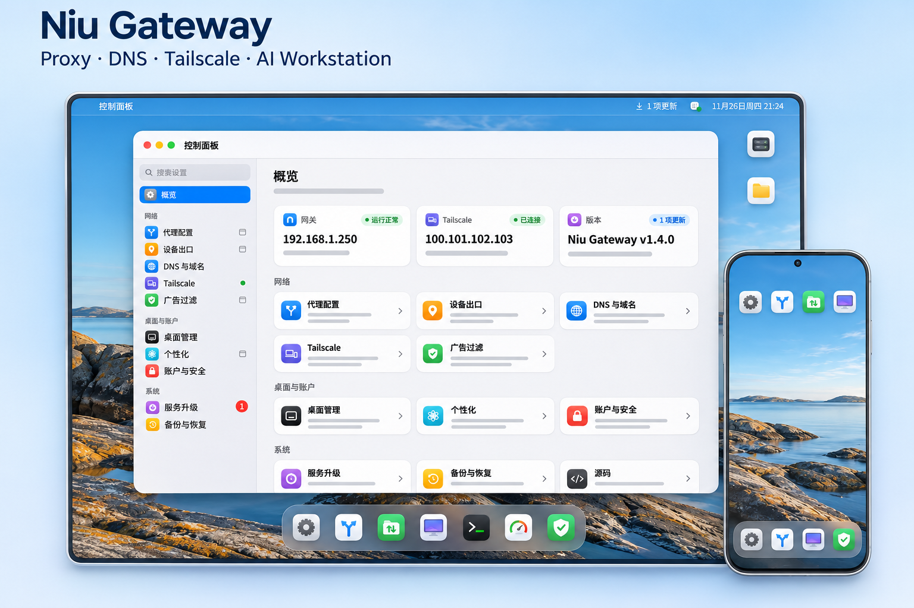

# AI Workstation & Gateway

[简体中文](README.md) | English

[](https://github.com/crazyniu/ai-workstation/actions/workflows/images.yml)
[](LICENSE)

Two containers for a home or office LAN:

- **Gateway**: a Mihomo (Clash) transparent proxy, AdGuard Home DNS, Tailscale subnet routing, and a desktop-style web console. Subscriptions, exits, per-device exits and domain groups are all configured in the browser.
- **Workstation**: a Debian + XFCE Linux development desktop with Chrome, VS Code, Codex, Claude Code and common MCP servers, used through the browser (noVNC), VNC or SSH.

Run both roles on one host or on two separate hosts. Docker works on Linux, Windows and macOS, and Linux also supports a native install. A LAN deployment defaults to `192.168.1.250` for the gateway and `192.168.1.251` for the workstation; any free addresses on your LAN work. The docs call the roles "250" and "251".

The web console and most of the documentation are in Simplified Chinese. This page covers what you need to install and run the project.



*Promotional image; the running version is authoritative. [About the images](docs/images/README.md)*

Screenshots of the actual UI: [gateway desktop](docs/images/gateway-control-panel.jpg), [Clash proxy editor](docs/images/gateway-clash-editor.jpg), [phone home screen](docs/images/gateway-home-mobile.jpg), [notifications](docs/images/gateway-global-toast-desktop.jpg).

## Features

| Role | Default address (configurable) | Provides | Public image |
| --- | --- | --- | --- |
| Gateway | `192.168.1.250` | Mihomo / Clash, AdGuard Home, Tailscale, web console | `ghcr.io/crazyniu/ai-workstation-gateway` |
| Workstation | `192.168.1.251` | XFCE, Chrome, VS Code, Codex, Claude Code, Claude Desktop, GitHub CLI, MCP tools | `ghcr.io/crazyniu/ai-workstation` |

- The gateway's port-80 page is a desktop with a menu bar and Dock, with icons in the macOS 27 style. The control panel, proxy editor, LAN file transfer, the workstation desktop, the Clash dashboard (MetaCubeXD), AdGuard Home and your own links open in windows on the same page. On a phone it becomes a home screen.
- Drag any icon to any place on the desktop, or into and out of the Dock. "About This Gateway" in the menu bar shows the version and the GitHub repository.
- The gateway has a Terminal app ([ttyd](https://github.com/tsl0922/ttyd), open source) that opens a root shell on the gateway in a desktop window. It ships with the gateway image and is available only while password login is on.
- The Tailscale page lists every device with its online state, addresses, traffic and connection path (direct, or DERP relay with the relay's name), and links to Tailscale's access controls, where you configure your own DERP relay servers.
- The proxy editor assigns an HTTP, HTTPS or SOCKS5 exit to a single IP, an IP range or a subnet, chained through a relay node from your subscription. HTTP and HTTPS exits always go through the relay; for SOCKS5 it is the default. You can also create groups (for example Google or YouTube) and route their domains to a chosen exit. Every change goes into a draft that you apply or discard.
- Desktop links can fetch site favicons or use custom icons, and can open in a new tab instead of a window. Wallpaper, theme, layout and account settings are stored on the gateway.
- The gateway asks for a password by default; on a trusted private network you can turn that off in the account settings. The workstation serves an HTTPS noVNC desktop with two-way text clipboard.
- The gateway manages proxy configuration, DNS, subnet access, component upgrades, and backup and restore.
- The workstation joins the LAN directly and can open connections to a paired Mac running Orca. To restrict which LAN devices it can reach, keep the Orca port (or other device ports) with **niu.sh → 7** and then enable the optional [LAN isolation](docs/workstation-egress.md#显式启用隔离).
- Configuration, HOME and account identities stay inside each container. Public images contain only programs and default templates; you add your own subscriptions, identities and data.

## Quick start

1. On a machine with Docker Compose 2.33.1 or newer, clone the repository and create the private settings file:

   ```sh
   git clone https://github.com/crazyniu/ai-workstation.git
   cd ai-workstation
   cp .env.example .env
   chmod 600 .env
   ```

2. Pick a deployment:
   - **Try it locally**: run `./deploy.sh` (`.\deploy.ps1` on Windows PowerShell). The gateway is at `http://127.0.0.1:8080/` and the workstation at `https://127.0.0.1:6080/`; SSH is on ports 2223 and 2222.
   - **LAN deployment (Linux)**: in `.env`, set `LAN_INTERFACE`, `LAN_SUBNET`, `LAN_PREFIX`, `LAN_ROUTER`, `GATEWAY_ADDRESS` and `WORKSTATION_ADDRESS` for your network and change the default passwords. Then run `./deploy.sh all` (one host), or `./deploy.sh gateway` and `./deploy.sh workstation` on separate hosts.
   - **Let an AI install it**: copy one of the [prompts below](#let-an-ai-install-or-upgrade-a-container).
3. Open the gateway, import your own Clash / Mihomo configuration or subscription in the proxy editor and apply it. See [Getting started](#getting-started).

The default container administrator is **`root / root`**, the workstation desktop user is `dev / dev`, and the VNC and gateway web password is `root`. Change them before exposing the containers on your LAN.

## Let an AI install or upgrade a container

Give one of these prompts to an AI agent that can operate the target Docker host. It first asks for your country and both LAN addresses (defaults `192.168.1.250` and `192.168.1.251`), then deploys only the named role.

### Install the gateway

```text
Follow AI-INSTALL.md in https://github.com/crazyniu/ai-workstation and install only the gateway.
First ask me for the installation country and for the gateway and workstation LAN addresses (defaults 192.168.1.250 and 192.168.1.251). After I confirm, pass them in AI_INSTALL_COUNTRY, AI_INSTALL_GATEWAY_ADDRESS and AI_INSTALL_WORKSTATION_ADDRESS, then run ./deploy.sh ai gateway from the repository root. Use only ghcr.io/crazyniu/ai-workstation-gateway:latest and install nothing else.
Container SSH uses root/root and the gateway web password is root. Stop if the address is taken or a gateway already exists.
```

### Install the workstation

```text
Follow AI-INSTALL.md in https://github.com/crazyniu/ai-workstation and install only the workstation.
First ask me for the installation country and for the gateway and workstation LAN addresses (defaults 192.168.1.250 and 192.168.1.251). After I confirm, pass them in AI_INSTALL_COUNTRY, AI_INSTALL_GATEWAY_ADDRESS and AI_INSTALL_WORKSTATION_ADDRESS, then run ./deploy.sh ai workstation from the repository root. Use only ghcr.io/crazyniu/ai-workstation:latest and install nothing else.
The container administrator is root/root, the desktop user is dev/dev and the VNC password is root. Stop if the address is taken, a workstation already exists, or the gateway is unavailable.
```

### Upgrade the gateway

```text
Follow AI-INSTALL.md in https://github.com/crazyniu/ai-workstation and upgrade only the existing gateway to ghcr.io/crazyniu/ai-workstation-gateway:latest.
Check the current container, its address, its startup definition and image digest. Back up as described in gateway/README.md before replacing it, then restore the configuration, accounts and identities and keep the same address. Leave the workstation as it is and install nothing else.
```

### Upgrade the workstation

```text
Follow AI-INSTALL.md in https://github.com/crazyniu/ai-workstation and upgrade only the existing workstation to ghcr.io/crazyniu/ai-workstation:latest.
Check the current container, its address, its startup definition and image digest. Back up as described in workstation/README.md before replacing it, then restore projects, desktop, accounts and SSH identities and keep the same address. Leave the gateway as it is and install nothing else.
```

The AI entry point checks the effective Compose plan before pulling: the role, the image, that both addresses differ and lie inside the configured LAN, and that they match what you confirmed. It writes the confirmed addresses and region to `.env` and refuses to touch existing containers.

## Platforms

Linux can use native services or Docker; Windows and macOS use Linux containers in Docker Desktop. Each role is built for every CPU its upstream software supports: the full workstation for amd64/x64 and arm64, and the gateway additionally for 32-bit x86, ARMv5/ARMv7 and RISC-V. See [docs/platforms.md](docs/platforms.md) for the full matrix and native install steps.

A LAN deployment needs Docker Engine on Linux, macvlan and a physical LAN interface; the gateway also needs `/dev/net/tun`. Portable mode binds its ports to the loopback address by default.

## Deployment options

| Deployment | First-run command | Compose file |
| --- | --- | --- |
| AI install, gateway | `./deploy.sh ai gateway` | `compose.gateway.yaml` |
| AI install, workstation | `./deploy.sh ai workstation` | `compose.workstation.yaml` |
| Portable Docker with port mapping | `./deploy.sh` / `.\deploy.ps1` | `compose.portable.yaml` |
| One Linux host, one LAN | `./deploy.sh all` | `compose.yaml` |
| Host B: gateway only | `./deploy.sh gateway` | `compose.gateway.yaml` |
| Host A: workstation on the same LAN | `./deploy.sh workstation` | `compose.workstation.yaml` |
| Host A: workstation across subnets or VPN | `./deploy.sh workstation-bridge` | `workstation/compose.yaml` |

`deploy.sh` only creates new environments: it stops if it finds any container of the project, including stopped ones. For later operations keep using the same Compose file, for example `docker compose --env-file .env -f compose.workstation.yaml restart workstation`.

When the roles run on separate hosts, set up and check the gateway first. Each host keeps its own clone and `.env`. Across subnets, point `WORKSTATION_HTTP_PROXY` and `WORKSTATION_HTTPS_PROXY` on host A at a gateway proxy endpoint it can reach.

## Getting started

1. Open the gateway at `http://<gateway address>/`. In the proxy editor, import your own Clash / Mihomo YAML or add a subscription, then apply. Pick nodes in the Clash dashboard.
2. Point clients at the gateway for DNS, then reach the console at `http://home.arpa`. To proxy a whole device, also set its default gateway to the gateway address.
3. Sign in to your own Tailscale account in the Tailscale settings and approve the subnet route as prompted.
4. Open the workstation from the gateway desktop or over VNC (`<workstation address>:5901`), or SSH in as `dev`. Sign in to Codex, Claude, GitHub and other accounts inside the apps.

| Entry point | Initial credentials |
| --- | --- |
| Gateway web: `http://<gateway address>/` | `WEB_PASSWORD`, example `root` |
| Gateway SSH: `<gateway address>:22` | `GATEWAY_USER` / `GATEWAY_PASSWORD`, example `root` / `root` |
| Workstation SSH: `<workstation address>:22` | administrator `root / root`; user `dev / dev` |
| Workstation VNC: `<workstation address>:5901` | `VNC_PASSWORD`, example `root` (1–8 ASCII characters) |
| Workstation web desktop: `https://<workstation address>:6080/` | same as VNC |

The workstation defaults to Singapore English (`WORKSTATION_COUNTRY=SG`, `WORKSTATION_LANGUAGE=en`, `WORKSTATION_TIMEZONE=Asia/Singapore`). Set all three together, for example `TW / zh / Asia/Taipei` or `US / en / America/Los_Angeles`. These settings change only the container's language, formats and clock, not the proxy egress.

More detail: [gateway guide](gateway/README.md), [workstation guide](workstation/README.md), [AI install guide](AI-INSTALL.md) (Chinese).

## Data and upgrades

The Docker deployments declare no bind mounts, named volumes or anonymous volumes for user data. Data lives in each container's writable layer, on the disk that holds Docker's `data-root`.

**Restarting a container keeps its data; deleting or recreating it loses that data.** Before replacing an image, export the private state you need and verify the restore procedure: see [gateway data handling](gateway/README.md) and [workstation backup and restore](workstation/README.md). Keep personal state, recovery images and credentials in private storage.

Component upgrades inside the gateway web console keep the configuration in `/data` and roll back on failure. The web backend, nginx, Python and the base system are updated by replacing the image.

## Development

```sh
python3 -m venv .venv
. .venv/bin/activate
python3 -m pip install PyYAML
python3 -m unittest discover -s gateway/tests -v
python3 -m unittest discover -s tests -p 'test_*.py' -v
for test in workstation/tests/test-*.py; do python3 "$test"; done
```

Container builds and smoke tests need Linux Docker; the full command list is in the [Chinese README](README.md#开发与验证). Pull requests run the fast checks; one that changes an image's build definition also builds that image for amd64, and the `full-ci` label verifies every architecture. After a merge, GitHub Actions rebuilds the changed images for each CPU architecture, runs startup, internal-storage, native-install and image-layer checks, and publishes `latest` and `sha-<commit>` tags from `main`. Pin a SHA tag to use a verified build.

| Path | Contents |
| --- | --- |
| [`gateway/`](gateway/) | Web console, gateway runtime, component lock file and tests |
| [`workstation/`](workstation/) | Desktop environment, tool installation, startup configuration and tests |
| [`compose.portable.yaml`](compose.portable.yaml) | Portable Docker deployment for Linux, Windows and macOS |
| [`compose.yaml`](compose.yaml) | Both roles on one Linux LAN host |
| [`compose.gateway.yaml`](compose.gateway.yaml), [`compose.workstation.yaml`](compose.workstation.yaml) | Each role on its own host on the same LAN |
| [`workstation/compose.yaml`](workstation/compose.yaml) | Bridge workstation for routed or private-proxy access |
| [`install-native.py`](install-native.py) | Linux native install with conflict checks |
| [`AI-INSTALL.md`](AI-INSTALL.md) | Topology, initialization, migration and checks for AI installers |
| [`tests/`](tests/) | Deployment entry-point tests |

## Contributing

Issues and pull requests are welcome, in English or Chinese.

- Bugs and feature ideas: use the [issue templates](https://github.com/crazyniu/ai-workstation/issues/new/choose) and include the image SHA, the deployment type and redacted steps to reproduce.
- Code: read [CONTRIBUTING.md](CONTRIBUTING.md) and run the checks above; attach screenshots for UI changes.
- Security issues: do not file them publicly; report them privately as described in [SECURITY.md](SECURITY.md).
- Please follow the [Code of Conduct](CODE_OF_CONDUCT.md).

## License

The project's own code is under the [MIT License](LICENSE). Third-party components, fonts, editor dependencies and software installed into the images keep their own licenses; see [NOTICE](NOTICE) and the [gateway third-party list](gateway/NOTICE).
