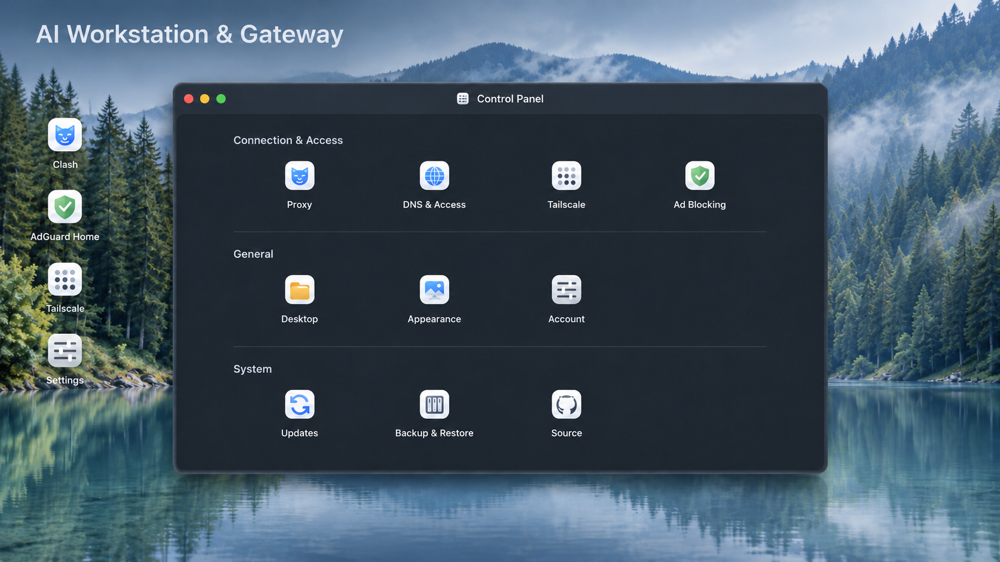

# AI Workstation & Gateway

[](https://github.com/crazyniu/ai-workstation/actions/workflows/images.yml)
[](LICENSE)

面向家庭网络与远程开发的双容器环境：一个带桌面式 Web 后台的网关，一个可通过 SSH / VNC 使用的 Linux 开发工作站。

工作站默认新加坡英文，可配置国家、语言和时区。两个角色既可同机运行，也可分别部署在宿主机 A/B；独立部署入口、网络前提和初始化参数见 [AI 安装指南](AI-INSTALL.md)。

## 让 AI 帮你安装

点击下面代码块右上角的复制按钮，发送给能操作你主机的 AI 助手。也可以直接发送本仓库链接并说明“请按仓库的 AI-INSTALL.md 帮我安装”；仓库提供 [AI 安装指引](AI-INSTALL.md) 和 [Agent 入口](AGENTS.md)。

```text
请帮我安装 https://github.com/crazyniu/ai-workstation 。
先读取仓库 README.md、AGENTS.md 和 AI-INSTALL.md，按实际主机环境执行。

目标是在 Linux amd64 / NAS Docker 主机上部署两个服务：
Clash 网关默认 192.168.1.250，Claude 开发工作站默认 192.168.1.251。
先确定网关和工作站是否位于同一宿主机；分开时分别盘点 A/B。
先检查 Docker、Compose、LAN 网卡、路由、地址占用以及已有容器和数据。
地址和网卡必须依据现场核实；缺少关键参数时向我询问，不能猜测。

两个服务的配置、HOME 和身份保存在容器内部，不添加业务目录挂载或数据卷。
发现已有部署时先说明现状和方案，不删除或重建已有容器，不改动其他服务。
首次安装使用仓库 deploy.sh；密码通过私有 .env 配置，不回显，不提交 Git。
不擅自迁移 Docker 存储、修改主路由器或向公网开放端口。
工作站默认 WORKSTATION_COUNTRY=SG、WORKSTATION_LANGUAGE=en、
WORKSTATION_TIMEZONE=Asia/Singapore；按 AI-INSTALL.md 配置和验收。

完成后验证容器状态、实际地址、Mounts、网关网页/DNS/代理、工作站 SSH/VNC，
核对 Python 和工具版本；需要账号登录的服务交由我登录后再验证。
最后给我访问入口、实际通过和未验证项目，以及重启、备份和重建的数据注意事项。
```



*项目展示图；实际界面以运行版本为准。[图片说明](docs/images/README.md)*

## 两个服务

| 服务 | 默认地址 | 能力 | 公开镜像 |
| --- | --- | --- | --- |
| Gateway | `192.168.1.250` | Mihomo / Clash、AdGuard Home、Tailscale、Web 控制面板 | `ghcr.io/crazyniu/ai-workstation-gateway` |
| Workstation | `192.168.1.251` | XFCE、Chrome、VS Code、Godot、Codex、Claude、GitHub CLI、MCP 工具 | `ghcr.io/crazyniu/ai-workstation` |

- 桌面链接支持自动获取站点 favicon，也可手动选图标；提供壁纸、主题、排序与账户设置。
- 网关统一管理代理配置、DNS、子网访问、组件升级与备份恢复。
- LAN 部署中，工作站的桌面和 CLI 默认经网关代理访问外网，局域网地址绕过显式代理；bridge 部署使用配置的私有代理端点，代理留空时沿用宿主机正常出口。
- 配置、HOME 和账号身份全部保存在各自容器内部。公开镜像包含程序和默认模板，个人订阅、身份和业务数据由用户自行配置。

## 每个容器的软件

以下清单对应仓库的镜像构建定义。固定版本以 [网关组件锁定文件](gateway/components.lock.json)、[工作站版本文件](workstation/versions.env) 和 [MCP 依赖锁定文件](workstation/mcp/package-lock.json) 为准；通过 Ubuntu APT 安装的软件版本由构建时的软件源决定。

### `192.168.1.250`：Clash 网关

| 类别 | 安装的软件 |
| --- | --- |
| 代理与面板 | Mihomo `1.19.33`、MetaCubeXD `1.273.1` |
| DNS 与过滤 | AdGuard Home `0.107.79`、内置 AdGuard DNS filter 规则快照 |
| 远程网络 | Tailscale `1.104.2` |
| Web 后台 | 项目网关桌面、WinBox `0.2.82`、CodeMirror YAML 编辑器 |
| 系统与运行时 | Ubuntu `24.04`、发行版系统 Python 3 / PyYAML、Nginx、Supervisor、Tini |
| 管理工具 | OpenSSH Server、Git、GitHub CLI、curl、DNS 查询及路由/防火墙工具 |

### `192.168.1.251`：Claude 开发工作站

| 类别 | 安装的软件 |
| --- | --- |
| 桌面与连接 | Ubuntu `26.04`、XFCE、Thunar 文件管理器、XFCE Terminal、TigerVNC、OpenSSH Server |
| 浏览器与编辑器 | Google Chrome `156.0.8078.47`、Visual Studio Code `1.143.1`、Godot `4.7.2` |
| AI CLI | Codex `0.164.0`、Claude Code `2.1.309` |
| 开发运行时 | Python 3（Ubuntu 软件包，`3.14` 系列）、Node.js `24.22.1`、npm / npx、GCC |
| 开发与进程管理 | Git、GitHub CLI、curl、Supervisor；Ubuntu 系统 Python `3.14` 用于系统服务 |
| 本地 MCP | Context7 `4.4.4`、Playwright `0.0.83`、Chrome DevTools `1.12.0`、Godot MCP `0.1.1` |
| 远程 MCP | GitHub MCP 连接配置，使用个人账号授权 |

工作站通过 `python3` 使用 Ubuntu 提供的 Python `3.14` 系列，补丁版本随系统软件包更新。MCP 配置同时提供给 Codex 和 Claude，浏览器工具使用容器内的 Chrome。详细清单与使用方式见 [工作站说明](workstation/README.md)。

## 首次部署

下面示例为同机 LAN 部署。分开部署时先按 [AI 安装指南](AI-INSTALL.md#0-先确定角色宿主机和网络拓扑) 选择宿主机 A/B 的独立入口；不同网段的工作站使用 bridge 与可达的私有代理端点。

需要接入局域网的 **Linux amd64 主机**、Docker Engine、**Docker Compose 2.33.1 或更新版本**、macvlan 支持和 `/dev/net/tun`。提前为两个容器保留未占用的 LAN 地址。Docker Desktop 默认虚拟网络不适用于这套地址方案。

```sh
git clone https://github.com/crazyniu/ai-workstation.git
cd ai-workstation
cp .env.example .env
chmod 600 .env
# 编辑 .env：网卡、路由器、容器地址、初始密码，以及需要访问的 NAS 宿主地址
./deploy.sh
```

[`.env.example`](.env.example) 列出全部参数。`LAN_INTERFACE` 必须是实际 LAN 网卡；需要访问 NAS 宿主时填写 `HOST_ADDRESS`。网关使用 control bridge 到达宿主，再为工作站转发该地址的访问。

`deploy.sh` 只用于首次创建：项目已有运行中或已停止的容器时会拒绝执行，避免重新创建容器覆盖内部数据。日常重启使用 `docker compose restart`。

### 按宿主机选择部署入口

工作站 251 可以位于宿主机 A，网关 250 可以位于宿主机 B。每台机器分别保存仓库和私有 `.env`，独立设置本机网卡、网络、密码与镜像版本。

| 部署方式 | 首次创建命令 | Compose 文件 |
| --- | --- | --- |
| 同一宿主机、同一 LAN | `./deploy.sh` | `compose.yaml` |
| 宿主机 B：独立网关 | `./deploy.sh gateway` | `compose.gateway.yaml` |
| 宿主机 A：同一 LAN 的工作站 | `./deploy.sh workstation` | `compose.workstation.yaml` |
| 宿主机 A：跨网段或 VPN 的工作站 | `./deploy.sh workstation-bridge` | `workstation/compose.yaml` |

分开部署时先验收 B 的网关，再部署 A 的工作站。同一 LAN 的两个角色使用各自宿主机的 `LAN_INTERFACE`，通过实际 LAN 地址通信。跨网段时，在 A 的 `.env` 中将 `WORKSTATION_HTTP_PROXY` 和 `WORKSTATION_HTTPS_PROXY` 指向已确认可达的网关私有代理端点；该模式保留 A 的正常路由，DNS、UDP 与整机出口按实际网络单独配置。bridge 的 SSH/VNC 默认绑定 A 的 `127.0.0.1`，通过到 A 的 SSH 隧道访问。

后续操作使用本次实际选定的 Compose 文件，例如在宿主机 A 的同 LAN 工作站部署目录中：

```sh
docker compose --env-file .env -f compose.workstation.yaml ps
docker compose --env-file .env -f compose.workstation.yaml restart workstation
```

网关部署使用 `compose.gateway.yaml`；bridge 工作站使用 `workstation/compose.yaml`。独立入口通过网络连接远端网关，无需在 A 上同时运行 gateway 容器。各拓扑的前提与检查步骤见 [AI 安装指南](AI-INSTALL.md#0-先确定角色宿主机和网络拓扑)。

### 工作站国家、语言和时区

初始化默认使用新加坡英文，私有 `.env` 中对应参数为：

```dotenv
WORKSTATION_COUNTRY=SG
WORKSTATION_LANGUAGE=en
WORKSTATION_TIMEZONE=Asia/Singapore
```

国家使用大写两位代码，语言使用小写语言代码，两者组合为 `en_SG.UTF-8`；时区独立使用 IANA 名称。例如台湾繁体中文为 `TW / zh / Asia/Taipei`，美国英文（纽约）为 `US / en / America/New_York`。初始化按需生成镜像支持的 locale，并将配置应用到 SSH 登录和 XFCE 会话。

已有容器可通过内部 `/etc/workstation/region.json` 覆盖地区配置，再重启同一容器；提供的字段优先于容器环境变量。修改 `.env` 后重启不会更新已有容器的环境变量定义。配置文件写法、参数校验和验收命令见 [AI 安装指南](AI-INSTALL.md#21-工作站国家语言和时区初始化)。地区设置控制容器内部语言、格式和时间，公网出口由网关和代理配置决定。

地区初始化功能要求所选镜像包含 `/etc/workstation/region.py`。当前源码的验证与公开镜像发布状态见 [验证记录](workstation/VALIDATION.md)；部署前核对实际镜像版本。

### LAN 访问入口

| 入口 | 初始账号 / 密码 |
| --- | --- |
| 网关 Web：`http://192.168.1.250/` | 密码来自 `WEB_PASSWORD`，示例值为 `admin` |
| 网关 SSH：`192.168.1.250:22` | `GATEWAY_USER` / `GATEWAY_PASSWORD`，示例均为 `admin` |
| 工作站 SSH：`192.168.1.251:22` | `dev` / `WORKSTATION_PASSWORD`，示例密码为 `admin` |
| 工作站 VNC：`192.168.1.251:5901` | `VNC_PASSWORD`，示例值为 `admin` |

部署前设置自己的密码。VNC 密码接受 1–8 个 ASCII 字符；工作站 root 默认锁定。网关 Web 密码首次初始化后由“设置 → 账户”管理。后续环境变量变更与数据处理见各服务文档。

## 开始使用

1. 打开网关主页，在代理配置中导入自己的 Clash / Mihomo YAML 并应用，通过 Clash 面板选择节点。
2. 让客户端使用网关 DNS 后，通过 `http://home.arpa` 访问主页。需要代理整个设备时，同时将该设备的默认网关设为网关容器地址。
3. 在 Tailscale 设置中登录自己的账号，并按页面提示批准子网路由。
4. 通过 VNC 打开工作站桌面，或通过 SSH 登录 `dev`。在应用内完成 Codex、Claude、GitHub 等个人账号登录。

```sh
docker compose ps
docker compose logs --tail 100 gateway
docker compose exec --user 1100:1100 -e HOME=/home/dev workstation gh auth login
```

更多配置见 [网关使用说明](gateway/README.md) 和 [工作站使用说明](workstation/README.md)。

## 数据与升级

两个服务不声明业务 bind mount、命名卷或匿名卷。数据写入容器层，底层位置由宿主的 Docker `data-root` 决定；建议放在 SSD，Compose 本身不会迁移宿主存储。

**重启保留数据；删除或重新创建容器会丢失内部数据。** 替换镜像前，先停止业务、导出需要保留的私有状态，并验证恢复流程。完整私有镜像用于原环境恢复；升级到新镜像需要选择性迁移配置和用户数据。操作步骤见 [网关数据处理](gateway/README.md) 和 [工作站备份与恢复](workstation/README.md)。个人状态、恢复镜像和凭据应留在私有存储中。

网关 Web 内的组件升级会保留 `/data` 中的配置，失败时回退组件。后台代码、Nginx、Python 与基础系统通过替换镜像更新。

## 开发与验证

```sh
python3 -m venv .venv
. .venv/bin/activate
python3 -m pip install PyYAML
python3 -m unittest discover -s gateway/tests -v
python3 -m unittest discover -s tests -p 'test_deploy.py' -v
for test in workstation/tests/test-*.py; do python3 "$test"; done

python3 gateway/scripts/fetch-components.py amd64
docker build --build-arg TARGETARCH=amd64 -t gateway-local:test gateway
bash gateway/tests/clean-smoke.sh gateway-local:test
docker image save gateway-local:test | python3 gateway/tests/audit-image.py

docker build -t workstation-local:test workstation
bash workstation/tests/smoke.sh workstation-local:test
bash workstation/tests/internal-storage.sh workstation-local:test
docker image save workstation-local:test | python3 workstation/tests/audit-image.py
```

容器验证需要 Linux Docker 环境。GitHub Actions 会构建两个干净镜像，运行启动、内部存储和镜像层检查；主分支验证通过后发布 `latest` 与 `sha-<完整提交号>` 标签。使用固定 SHA 标签可选择已验证的版本。实时进度见 [Actions](https://github.com/crazyniu/ai-workstation/actions/workflows/images.yml)。

| 路径 | 内容 |
| --- | --- |
| [`gateway/`](gateway/) | Web 后台、网关运行时、组件锁定文件和测试 |
| [`workstation/`](workstation/) | 桌面环境、工具安装、启动配置和测试 |
| [`compose.yaml`](compose.yaml) | 双容器网络与运行参数 |
| [`compose.gateway.yaml`](compose.gateway.yaml) | 宿主机 B 的独立网关部署 |
| [`compose.workstation.yaml`](compose.workstation.yaml) | 宿主机 A 的同 LAN 工作站部署 |
| [`workstation/compose.yaml`](workstation/compose.yaml) | 跨网段私有代理或独立 bridge 工作站部署 |
| [`AI-INSTALL.md`](AI-INSTALL.md) | 面向 AI 的拓扑选择、初始化、迁移和验收指南 |
| [`tests/`](tests/) | 部署入口保护测试 |
| [`docs/`](docs/) | 项目展示素材与来源说明 |

欢迎提交问题和 Pull Request。开发约定见 [CONTRIBUTING.md](CONTRIBUTING.md)，漏洞报告见 [SECURITY.md](SECURITY.md)。

## 许可

仓库自有代码采用 [MIT License](LICENSE)。第三方组件、字体、编辑器依赖及随镜像安装的软件按各自许可分发；MIT 不替代这些许可。来源与素材说明见 [NOTICE](NOTICE) 和 [网关第三方清单](gateway/NOTICE)。
