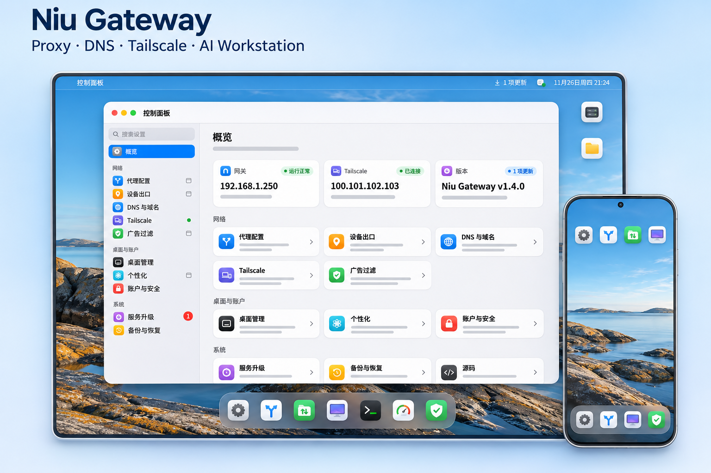
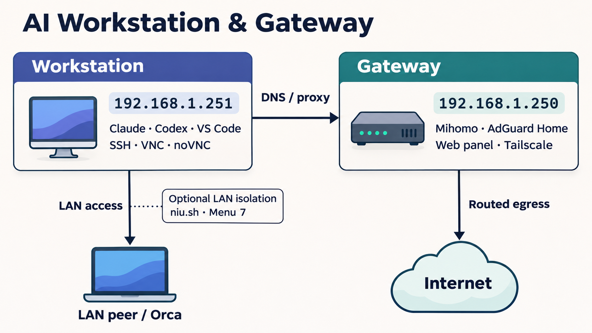

# Niu Gateway & AI Workstation

简体中文 | [English](README.en.md)

[](https://github.com/crazyniu/ai-workstation/actions/workflows/images.yml)
[](LICENSE)

在家庭或办公室局域网里部署两个容器：

- **网关 Niu Gateway**：Mihomo（Clash）透明代理、AdGuard Home DNS、Tailscale 子网路由，以及一个 macOS 风格的桌面式 Web 后台，带网页终端。订阅地址、中转出口、设备出口和分组规则都可以在网页里配置。
- **工作站**：Debian + XFCE 的 Linux 开发桌面，预装 Chrome、VS Code、Codex、Claude Code 和常用 MCP，通过浏览器（noVNC）、VNC 或 SSH 使用。

两个角色可以同机运行，也可以分别部署在两台宿主机上；支持 Linux、Windows、macOS 上的 Docker，以及 Linux 原生安装。局域网部署的默认地址是网关 `192.168.1.250`、工作站 `192.168.1.251`，可以换成你局域网里的其他空闲地址。文档中的“250”“251”分别指网关和工作站。



*AI 生成的项目展示图，实际界面以运行版本为准。[图片说明](docs/images/README.md)*

实际界面截图：[控制面板](docs/images/gateway-control-panel.jpg)、[暗色模式与 Tailscale 设备](docs/images/gateway-control-panel-dark.jpg)、[代理配置](docs/images/gateway-clash-editor.jpg)、[账户与安全](docs/images/gateway-password-login.jpg)、[手机主屏](docs/images/gateway-home-mobile.jpg)、[手机尺寸控制面板](docs/images/gateway-control-panel-mobile.jpg)、[操作提示](docs/images/gateway-global-toast-desktop.jpg)。

## 功能

| 角色 | 默认地址（可自定义） | 能力 | 公开镜像 |
| --- | --- | --- | --- |
| Niu Gateway | `192.168.1.250` | Mihomo / Clash、AdGuard Home、Tailscale、桌面式 Web 后台、网页终端 | `ghcr.io/crazyniu/ai-workstation-gateway` |
| Workstation | `192.168.1.251` | XFCE、Chrome、VS Code、Codex、Claude Code、Claude Desktop、GitHub CLI、MCP 工具 | `ghcr.io/crazyniu/ai-workstation` |

- 桌面图标可以拖到任意位置，也可以拖进或拖出 Dock；网关应用和自定义链接都一样。窗口可以自由拉伸，宽高最大到整个浏览器窗口（下边缘可以延伸到 Dock 后面），绿色缩放按钮仍停在 Dock 上方。
- 链接默认在桌面的窗口中打开，可改为新标签页。网站不允许被嵌入显示，或者只能作为独立页面运行（例如 NAS 的网页桌面）时，窗口会说明原因，并提供新标签页打开和“以后都在新标签页打开”。
- 桌面链接支持自动获取站点 favicon，也可手动选图标；应用和设置图标采用 macOS 风格。提供壁纸、主题与账户设置，菜单栏的“关于 Niu Gateway”显示版本和 GitHub 开源地址；有新版本时，更新窗口按 Markdown 显示发布说明。
- 网关内置工作站入口，在窗口中打开工作站桌面，可修改地址；保存、导入和表单校验通过全局提示反馈。
- 网关自带“终端”（开源的 [ttyd](https://github.com/tsl0922/ttyd)），在桌面窗口中打开网关的 root shell。它和网关其他页面使用同一个登录设置（“账户与安全 → 登录需要密码”），随网关镜像提供。
- Tailscale 页面列出所有设备的在线状态、地址、流量和连接方式（直连、DERP 中继及中继名称），并提供 Tailscale 访问控制的入口，用于配置自建 DERP 中继服务器。
- 网关默认使用密码登录，可信私网可在“账户与安全”中关闭，关闭后网页终端同样无需密码；工作站提供 HTTPS noVNC 网页桌面，支持双向文字剪贴板。
- 网关统一管理代理配置、DNS、子网访问、组件升级与备份恢复。
- 工作站默认直接接入局域网，可主动连接 Mac 的 Orca 配对服务，网关继续负责公网代理。需要限制工作站主动访问其他内网设备时，可用 **niu.sh → 7** 保留 Mac 的 Orca 端口或其他指定设备端口，再显式启用[可选隔离](docs/workstation-egress.md#显式启用隔离)。
- 在代理配置的“设备出口”里，把软件或来源 IP 绑定到具体 HTTP、HTTPS 或 SOCKS5 出口，HTTP 和 HTTPS 出口固定经过订阅里的中转节点；也可以在“分组规则”里新建分组（例如 Google、YouTube），为一组域名指定出口。该节点连接失败或不支持 UDP 时，命中的流量被拒绝。手动选用的其他节点和独立规则按其自身策略执行。详见[工作站网络策略](docs/workstation-egress.md)。
- 配置、HOME 和账号身份全部保存在各自容器内部。公开镜像包含程序和默认模板，个人订阅、身份和业务数据由用户自行配置。

## 快速开始

1. 准备一台装有 Docker Compose 2.33.1+ 的机器，克隆仓库并复制私有配置：

   ```sh
   git clone https://github.com/crazyniu/ai-workstation.git
   cd ai-workstation
   cp .env.example .env
   chmod 600 .env
   ```

2. 选择部署方式：
   - **本机试用**：直接运行 `./deploy.sh`（Windows 用 `.\deploy.ps1`）。网关在 `http://127.0.0.1:8080/`，工作站在 `https://127.0.0.1:6080/`。
   - **局域网部署（Linux）**：在 `.env` 中按实际网络填写 `LAN_INTERFACE`、`LAN_SUBNET`、`LAN_PREFIX`、`LAN_ROUTER`、`GATEWAY_ADDRESS` 和 `WORKSTATION_ADDRESS`，修改默认密码，然后运行 `./deploy.sh all`（同机）或分别运行 `./deploy.sh gateway`、`./deploy.sh workstation`。
   - **交给 AI**：复制[下方的指令](#让-ai-安装或升级容器)。
3. 打开网关主页，在代理配置中导入自己的 Clash / Mihomo 配置或订阅，详见[开始使用](#开始使用)。

默认管理员账号、密码为 **`root / root`**，工作站桌面用户为 `dev / dev`，VNC 密码为 `root`。用于局域网前请先修改。

## 让 AI 安装或升级容器

选一段复制给能操作目标 Docker 宿主机的 AI。AI 会先问你国家和两个局域网地址（默认网关 `192.168.1.250`、工作站 `192.168.1.251`），确认后再部署；地址可以换成你局域网里的其他空闲地址。

### 安装网关

```text
按 https://github.com/crazyniu/ai-workstation 的 AI-INSTALL.md，只安装网关。
先问我安装国家，以及网关和工作站的局域网地址（默认 192.168.1.250 和 192.168.1.251）。得到确认后用 AI_INSTALL_COUNTRY、AI_INSTALL_GATEWAY_ADDRESS 和 AI_INSTALL_WORKSTATION_ADDRESS 传入，再在仓库根目录执行 ./deploy.sh ai gateway，只用 ghcr.io/crazyniu/ai-workstation-gateway:latest，不额外安装软件。
容器 SSH 用 root/root，网关网页密码用 root。地址已占用或已有网关时停止。
```

### 安装工作站

```text
按 https://github.com/crazyniu/ai-workstation 的 AI-INSTALL.md，只安装工作站。
先问我安装国家，以及网关和工作站的局域网地址（默认 192.168.1.250 和 192.168.1.251）。得到确认后用 AI_INSTALL_COUNTRY、AI_INSTALL_GATEWAY_ADDRESS 和 AI_INSTALL_WORKSTATION_ADDRESS 传入，再在仓库根目录执行 ./deploy.sh ai workstation，只用 ghcr.io/crazyniu/ai-workstation:latest，不额外安装软件。
容器管理员用 root/root，桌面用户用 dev/dev，VNC 密码用 root。地址已占用、已有工作站或网关不可用时停止。
```

### 升级网关

```text
按 https://github.com/crazyniu/ai-workstation 的 AI-INSTALL.md，只将现有网关升级到 ghcr.io/crazyniu/ai-workstation-gateway:latest。
核对原容器、地址、启动配置和镜像摘要。按 gateway/README.md 备份后再替换网关，恢复配置、账号和身份，沿用原地址。保留工作站原状，不额外安装软件。
```

### 升级工作站

```text
按 https://github.com/crazyniu/ai-workstation 的 AI-INSTALL.md，只将现有工作站升级到 ghcr.io/crazyniu/ai-workstation:latest。
核对原容器、地址、启动配置和镜像摘要。按 workstation/README.md 备份后再替换工作站，恢复项目、桌面、账号和 SSH 身份，沿用原地址。保留网关原状，不额外安装软件。
```

## 支持的平台与安装方式

Linux 可选择原生服务或 Docker；Windows、macOS 使用 Docker Desktop 的 Linux 容器。两个角色按上游软件实际支持的 CPU 范围提供构建：完整工作站覆盖 amd64/x64 和 arm64；网关还覆盖 32 位 x86、ARMv5/ARMv7、RISC-V，并锁定其他上游可用架构的依赖。只有软件自身缺少对应版本时才说明限制。完整矩阵、命令和验证边界见[平台安装说明](docs/platforms.md)。

Linux 原生安装保留宿主已有的 root 密码。手动选用 portable 模式时，端口默认绑定本机回环地址。

## 系统架构

Linux 局域网部署中，250 和 251 可以运行在同一台或不同的 Docker 宿主机。图中的 IP 属于容器。



菜单 7 按**目标 IPv4、协议和端口**放行工作站主动发起的连接，例如到 Mac 的 Orca WebSocket。工作站对外提供的 SSH、VNC 和 noVNC 入口仍由部署配置管理。[LAN 隔离与端口放行说明](docs/workstation-egress.md)

## 让 AI 帮你检测 IP 泄漏

复制下面的提示词，发送给能连接目标环境的 AI 助手。将示例地址替换为实际部署地址；检测结果以当次实测为准。该提示词涵盖 HTTPS 出口、STUN / WebRTC、IPv6、DNS 和 Claude 连接，并要求保留现有配置与数据。

```text
请检查本项目工作站是否存在绕过代理、暴露真实公网 IP 的情况。
目标工作站示例为 192.168.1.251，网关示例为 192.168.1.250，
实际宿主机、容器或原生服务、访问入口和预期代理出口请先现场核实。
先读取 README.md、AGENTS.md、AI-INSTALL.md 和 docs/platforms.md。
本次仅检测，保持已有服务、代理、路由、防火墙、浏览器配置和用户数据原状；
使用当前可用的原生工具操作桌面和浏览器，确认测试运行在目标工作站。

1. 盘点实际网络：记录接口、地址、默认路由、策略路由、DNS、代理环境变量，
   以及浏览器、Claude Desktop / Claude Code 的运行状态与适用代理策略。
   区分工作站、网关、宿主机和控制端，核对多网卡、Docker / VPN 等额外路径。

2. 在工作站通过两个独立 HTTPS 查询服务测出口 IP，区分系统默认路径和
   应用实际使用的代理路径。与预期代理出口、可安全取得的宽带出口基线比较，
   并结合实时转发链判断；仅看到两个查询结果相同，证据仍不完整。

3. 从工作站实际发送 STUN Binding 请求，至少测试 Google STUN 的 19302
   和 Cloudflare STUN 的 3478 端口。记录当次解析地址，校验响应事务 ID，
   读取映射公网地址；对各可用接口分别检测。保持测试连接一段时间，
   同步核对网关实时连接的源 IP、协议、目标、命中规则和代理链。

4. 在目标工作站的实际浏览器中执行 WebRTC ICE 候选收集，记录浏览器版本、
   代理与 WebRTC 策略，区分 host、srflx、relay、mDNS、私网地址和公网地址。
   将候选中的公网 IPv4 / IPv6 与 HTTPS 出口、预期代理出口逐项比较。
   网络层 STUN 探测和浏览器完整 WebRTC 测试分别报告；缺少浏览器访问时，
   浏览器项记为 NOT RUN，同时继续完成可执行的网络检查。

5. 检查公网 IPv6 地址、IPv6 路由、DNS 的实际解析路径和 UDP/443 的转发链。
   有 IPv6 时分别验证其出口；DNS 结合查询、日志或限定范围的抓包取证，
   系统配置和检测页的解析服务商标签只作线索。区分 DNS 泄漏与公网 IP 泄漏。

6. 对正在运行的 Claude 及其子进程观察网络连接，记录观察时长、采样方式，
   尽量通过 PID、socket、源端口和时间关联转发记录。区分主动测试产生的
   STUN 请求与应用自身活动；未观察到连接仅代表观察窗口内的结果。
   登录、语音等未触发场景单列为未验证，记录需要用户配合的具体步骤。

7. 检查规则顺序、子规则、源地址强制代理、UDP 支持和直连回退策略。
   特别确认前面的工作站子规则是否优先于后面的通用 STUN / QUIC 拒绝规则。
   区分“已拦截”“经预期代理转发”“绕过代理直连”；STUN 可连通本身不能
   证明泄漏，超时也不能单独证明拦截。代理故障时的行为仅检查现有证据，
   停服务或切换出口的故障演练另列为未验证。

最后输出检测表：检查项、实际结果、关键证据、PASS / FAIL / NOT RUN，
并给出“确认泄漏 / 本次未发现泄漏 / 证据不足”的结论和适用范围。
发现问题时定位具体路径、规则与影响，并给出最小修复建议。
保留私有检测报告；公开文档使用脱敏示例，凭据、个人配置和原始日志留在私有位置。
```

## 每个容器的软件

以下清单对应仓库的镜像构建定义。固定版本以 [网关组件锁定文件](gateway/components.lock.json)、[工作站版本文件](workstation/versions.env) 和 [MCP 依赖锁定文件](workstation/mcp/package-lock.json) 为准；通过 Debian/Ubuntu APT 安装的软件版本由构建时的软件源决定。

### 网关（默认 `192.168.1.250`）

| 类别 | 安装的软件 |
| --- | --- |
| 代理与面板 | Mihomo `1.19.33`、MetaCubeXD `1.273.1` |
| DNS 与过滤 | AdGuard Home `0.107.79`、内置 AdGuard DNS filter 规则快照 |
| 远程网络 | Tailscale `1.104.2` |
| Web 后台 | Niu Gateway（本项目）、WinBox `0.2.82`、CodeMirror YAML 编辑器 |
| 系统与运行时 | Debian `13`、发行版系统 Python 3 / PyYAML、Nginx、Supervisor、Tini |
| 管理工具 | OpenSSH Server、Git、GitHub CLI、curl、DNS 查询及路由/防火墙工具 |
| 网页终端 | ttyd `1.7.7`（构建镜像时从固定版本的上游源码编译） |

### 工作站（默认 `192.168.1.251`）

| 类别 | 安装的软件 |
| --- | --- |
| 桌面与连接 | Debian `13`、XFCE、Thunar 文件管理器、XFCE Terminal、TigerVNC、noVNC `1.7.0`、websockify、OpenSSH Server |
| 浏览器与编辑器 | Google Chrome `156.0.8078.47`、Visual Studio Code `1.143.1` |
| AI CLI | Codex `0.164.0`、Claude Code `2.1.309` |
| 开发运行时 | Python 3（Debian 系统包）、Node.js `24.22.1`、npm / npx、GCC |
| 开发与进程管理 | Git、GitHub CLI、curl、Supervisor；系统 Python 3 用于系统服务 |
| 本地 MCP | Context7 `4.4.4`、Playwright `0.0.83`、Chrome DevTools `1.12.0` |
| 远程 MCP | GitHub MCP 连接配置，使用个人账号授权 |
| AI 桌面应用 | Claude Desktop；**niu.sh** 会和系统软件包、桌面应用、运行时、AI CLI 及本地 MCP 一起更新它。 |

工作站容器使用 Debian 提供的 Python 3，补丁版本随系统软件包更新。MCP 配置同时提供给 Codex 和 Claude，浏览器工具使用容器内的 Chrome。详细清单与使用方式见 [工作站说明](workstation/README.md)。

## 首次部署

AI 首次安装只执行所选角色的入口。脚本在拉取镜像前用 Python 3 核对 Compose 实际使用的角色、镜像，以及用户确认的 LAN 地址。

手动选用 portable 模式时，Linux、Windows、macOS 都可以使用 Docker Linux 容器和 Compose 2.33.1+。

```sh
git clone https://github.com/crazyniu/ai-workstation.git
cd ai-workstation
cp .env.example .env
chmod 600 .env
./deploy.sh
```

Windows PowerShell 执行 `Copy-Item .env.example .env` 后运行 `.\deploy.ps1`。默认入口为网关 `http://127.0.0.1:8080/`、工作站 `https://127.0.0.1:6080/`，SSH 分别为 2223/2222。默认管理员均为 `root / root`。

Linux 不安装 Docker 时使用 `python3 install-native.py` 预览，再按[原生安装流程](docs/platforms.md#linux-原生安装)执行。需要独立 LAN 地址和透明网关时使用下面的 Linux macvlan 入口，现场确认网卡、地址、TUN 和转发能力。

首次部署入口发现本项目已有容器（包括停止的容器）会退出，保留内部数据。后续操作继续指定本次选择的 Compose 文件；portable 模式使用 `docker compose --env-file .env -f compose.portable.yaml restart`。

### 按宿主机选择部署入口

工作站 251 可以位于宿主机 A，网关 250 可以位于宿主机 B。每台机器分别保存仓库和私有 `.env`，独立设置本机网卡、网络、密码与镜像版本。

| 部署方式 | 首次创建命令 | Compose 文件 |
| --- | --- | --- |
| AI 安装 250 网关 | `./deploy.sh ai gateway` | `compose.gateway.yaml` |
| AI 安装 251 工作站 | `./deploy.sh ai workstation` | `compose.workstation.yaml` |
| 通用 Docker 端口映射 | `./deploy.sh` / `.\deploy.ps1` | `compose.portable.yaml` |
| 同一 Linux 宿主机、同一 LAN | `./deploy.sh all` | `compose.yaml` |
| 宿主机 B：独立网关 | `./deploy.sh gateway` | `compose.gateway.yaml` |
| 宿主机 A：同一 LAN 的工作站 | `./deploy.sh workstation` | `compose.workstation.yaml` |
| 宿主机 A：跨网段或 VPN 的工作站 | `./deploy.sh workstation-bridge` | `workstation/compose.yaml` |

分开部署时先验收 B 的网关，再部署 A 的工作站。同一 LAN 的两个角色使用各自宿主机的 `LAN_INTERFACE`，通过实际 LAN 地址通信。跨网段时，在 A 的 `.env` 中将 `WORKSTATION_HTTP_PROXY` 和 `WORKSTATION_HTTPS_PROXY` 指向已确认可达的网关私有代理端点；该模式保留 A 的正常路由，DNS、UDP 与整机出口按实际网络单独配置。bridge 的 SSH/VNC 默认绑定 A 的 `127.0.0.1`，通过到 A 的 SSH 隧道访问。

后续操作使用本次实际选定的 Compose 文件，例如在宿主机 A 的同 LAN 工作站部署目录中：

```sh
docker compose --env-file .env -f compose.workstation.yaml ps
docker compose --env-file .env -f compose.workstation.yaml restart workstation
```

网关部署使用 `compose.gateway.yaml`；bridge 工作站使用 `workstation/compose.yaml`。独立入口通过网络连接远端网关，无需在 A 上同时运行 gateway 容器。各拓扑的前提与检查步骤见 [AI 安装指南](AI-INSTALL.md#0-先确定角色宿主机和网络拓扑)。

### 浏览器桌面与复制粘贴

工作站同时提供 VNC 和 noVNC 网页入口，访问 `https://工作站地址:6080/` 自动进入同一个 XFCE 桌面。通过左侧剪贴板面板双向传递中文和多行文字。首次启动生成容器内部的 HTTPS 证书，重启沿用；自签名证书首次访问需要在浏览器确认。bridge 入口仅映射宿主 `127.0.0.1:6080`，可通过 SSH 隧道使用。

可信内网需要免证书提示时，显式设置 `NOVNC_TLS=0`，改用 `http://工作站地址:6080/`；配合 `VNC_AUTH=none` 即为免密码 HTTP 桌面。此连接不加密，文字通过 noVNC 左侧剪贴板面板传递；依赖安全上下文的浏览器 API 会受限。默认仍为 `NOVNC_TLS=1` 的 HTTPS。自定义 `NOVNC_ALLOWED_ORIGINS` 必须与实际入口的协议和端口一致。

默认 `VNC_AUTH=password`，网页使用已有 VNC 密码。用户明确选择可信私网免密码时，在新建容器的私有 `.env` 设置 `VNC_AUTH=none`；这同时关闭网页和原生 VNC 的密码认证，SSH 仍使用自己的认证。能访问该端口的设备可以操作桌面，因此不要为免密码入口配置公网映射。网页不保存或嵌入 VNC 密码。

默认仅允许工作站自身 IP、hostname 和 localhost 对应协议的 WebSocket 来源；使用自定义域名、反向代理或不同外部端口时，设置 `NOVNC_ALLOWED_ORIGINS` 为实际入口来源，多个值用空格分隔。已有部署先保留内部数据，按实际运行入口配置服务；不要为添加网页桌面直接重建有数据的容器。

### 工作站国家、语言和时区

初始化默认使用新加坡英文，私有 `.env` 中对应参数为：

```dotenv
WORKSTATION_COUNTRY=SG
WORKSTATION_LANGUAGE=en
WORKSTATION_TIMEZONE=Asia/Singapore
```

国家使用大写两位代码，语言使用小写语言代码，两者通常组合为 `en_SG.UTF-8`；时区独立使用 IANA 名称。例如台湾繁体中文为 `TW / zh / Asia/Taipei`，美国英文（洛杉矶）为 `US / en / America/Los_Angeles`。台湾英语使用 `TW / en / Asia/Taipei`：英语界面采用 `en_US.UTF-8`，台湾日期、货币等地区格式采用 `zh_TW.UTF-8`，无需不存在的 `en_TW`。初始化按需生成所需 locale，并将配置应用到 SSH 登录和 XFCE 会话。

已有容器可通过内部 `/etc/workstation/region.json` 覆盖地区配置，再重启同一容器；提供的字段优先于容器环境变量。修改 `.env` 后重启不会更新已有容器的环境变量定义。配置文件写法、参数校验和验收命令见 [AI 安装指南](AI-INSTALL.md#21-工作站国家语言和时区初始化)。地区设置控制容器内部语言、格式和时间，公网出口由网关和代理配置决定。

地区初始化功能要求所选镜像包含 `/etc/workstation/region.py`。当前源码的验证与公开镜像发布状态见 [验证记录](workstation/VALIDATION.md)；部署前核对实际镜像版本。

### 重置 Claude 用户信息

以 `dev` 打开 **niu.sh**，菜单 **6** 可预览 Claude、Codex 图片及应用缓存的路径和占用空间。输入 **1** 清理列出的缓存，输入 **0** 取消。生成的图片、项目、聊天记录和登录配置保留。

以 `dev` 打开桌面的 **niu.sh**，输入 **5** 预览清理范围。关闭 Claude Code 后，输入 **1** 确认执行，或输入 **0** 取消。

清理 Claude Code 登录凭据、用户/设备标识、会话、输入历史、日志及旧配置备份；保留当前 MCP 配置、MCP OAuth 凭据、插件、技能、通用代理设置及实际项目文件。只修改选定 HOME 中的 Claude 数据及独立的认证变量声明，不清理浏览器登录、远端会话或共享 Shell 历史。执行时检查 Claude 进程及继承的认证环境变量，发现仍在使用的身份时拒绝清理。清理按需手动执行，容器启动不会自动重置账号。

命令随包含本次脚本的新镜像提供。完整范围、从宿主机执行的命令及验证方法见 [AI 安装指南](AI-INSTALL.md#22-手动重置-claude-code-用户信息)。

### LAN 访问入口

Niu Gateway 桌面内置“工作站”图标，默认在窗口中打开 `https://工作站地址:6080/`（按 `WORKSTATION_ADDRESS` 生成，例如 `https://192.168.1.251:6080/`），与工作站镜像默认协议一致。在“控制面板 → 桌面管理”或右键图标的“设置入口地址”中修改实际 IP、域名、协议和端口；可信内网 HTTP 服务填写对应的 `http://` 地址。工作站使用自签名证书时，浏览器需要先在新标签页中打开并选择继续访问一次，之后窗口才能显示；窗口会提示这一步。全部图标都可以拖到桌面任意位置或拖进 Dock，选中图标后也可用 `Alt + 方向键` 移动。地址和布局保存在网关内，刷新、重启及换浏览器后沿用，并包含在配置备份中。

| 入口 | 初始账号 / 密码 |
| --- | --- |
| Niu Gateway：`http://网关地址/` | 密码来自 `WEB_PASSWORD`，示例值为 `root` |
| 网关 SSH：`网关地址:22` | `GATEWAY_USER` / `GATEWAY_PASSWORD`，示例均为 `root` |
| 工作站 SSH：`工作站地址:22` | 管理员 `root / root`；应用用户 `dev / dev` |
| 工作站 VNC：`工作站地址:5901` | `VNC_PASSWORD`，示例值为 `root` |

部署前设置自己的密码。VNC 密码接受 1–8 个 ASCII 字符；Compose 默认启用工作站 root / root 管理登录，桌面应用仍由 dev 运行。Niu Gateway 密码首次初始化后在“控制面板 → 账户与安全”中修改。后续环境变量变更与数据处理见各服务文档。

可信私网可在“控制面板 → 账户与安全”关闭“登录需要密码”，输入当前密码后保存。关闭后，能访问网页的设备可直接管理网关、Clash 和 AdGuard Home，也可以使用网页终端；SSH 认证独立保留。重新开启仍需当前密码。登录开关和原密码保存在网关内部，重启沿用，均不随网页配置备份导出或恢复。全新容器默认开启密码登录，详见[网关账户说明](gateway/README.md#首次设置与日常使用)。

## 开始使用

1. 打开网关主页，在代理配置中导入自己的 Clash / Mihomo YAML 并应用，通过 Clash 面板选择节点。
2. 让客户端使用网关 DNS 后，通过 `http://home.arpa` 访问主页。需要代理整个设备时，同时将该设备的默认网关设为网关容器地址。
3. 在 Tailscale 设置中登录自己的账号，并按页面提示批准子网路由。
4. 点击网关“工作站”图标或通过 VNC 打开桌面，也可通过 SSH 登录 `dev`。在应用内完成 Codex、Claude、GitHub 等个人账号登录。

```sh
docker compose ps
docker compose logs --tail 100 gateway
docker compose exec --user 1100:1100 -e HOME=/home/dev workstation gh auth login
```

更多配置见 [网关使用说明](gateway/README.md) 和 [工作站使用说明](workstation/README.md)。

## 数据与升级

Docker 部署的两个服务不声明业务 bind mount、命名卷或匿名卷。数据写入容器层，底层位置由宿主的 Docker `data-root` 决定；建议放在 SSD，Compose 本身不会迁移宿主存储。

原生安装的状态与服务管理见[平台说明](docs/platforms.md#linux-原生安装)。

**重启保留数据；删除或重新创建容器会丢失内部数据。** 替换镜像前，先停止业务、导出需要保留的私有状态，并验证恢复流程。完整私有镜像用于原环境恢复；升级到新镜像需要选择性迁移配置和用户数据。操作步骤见 [网关数据处理](gateway/README.md) 和 [工作站备份与恢复](workstation/README.md)。个人状态、恢复镜像和凭据应留在私有存储中。

Niu Gateway 内的组件升级会保留 `/data` 中的配置，失败时回退组件。Niu Gateway 的管理页面和 API 单独发布在 [GitHub Releases](https://github.com/crazyniu/ai-workstation/releases)（标签 `gateway-web-vX.Y.Z`），有新版本时菜单栏会提示，在“服务升级”中查看发布说明并在线更新；Nginx、Python、ttyd 与基础系统通过替换镜像更新。

## 开发与验证

```sh
python3 -m venv .venv
. .venv/bin/activate
python3 -m pip install PyYAML
python3 -m unittest discover -s gateway/tests -v
python3 -m unittest discover -s tests -p 'test_*.py' -v
for test in workstation/tests/test-*.py; do python3 "$test"; done

python3 gateway/scripts/fetch-components.py amd64
docker build --platform linux/amd64 -t gateway-local:test gateway
bash gateway/tests/clean-smoke.sh gateway-local:test
docker image save gateway-local:test | python3 gateway/tests/audit-image.py

docker build -t workstation-local:test workstation
bash workstation/tests/smoke.sh workstation-local:test
bash workstation/tests/internal-storage.sh workstation-local:test
bash workstation/tests/web-desktop.sh workstation-local:test
docker image save workstation-local:test | python3 workstation/tests/audit-image.py
```

容器验证需要 Linux Docker 环境。PR 默认只运行快速检查；改动镜像构建定义时构建对应镜像的 amd64 版本，加 `full-ci` 标签可验证全部架构。合并到主分支后，GitHub Actions 按 CPU 架构重新构建有变化的镜像，运行启动、内部存储、原生安装和镜像层检查，通过后发布 `latest` 与 `sha-<完整提交号>` 标签。使用固定 SHA 标签可选择已验证的版本。实时进度见 [Actions](https://github.com/crazyniu/ai-workstation/actions/workflows/images.yml)。

默认分支通过 PR 和 `Required checks` 合并门槛保护，要求分支保持最新、审查讨论已解决，并禁止强推和删除。各类 PR 运行的检查见贡献指南，都报告同一个必过结果。规则说明见 [贡献指南](CONTRIBUTING.md#默认分支保护)，版本化定义见 [main Ruleset](.github/rulesets/main.json)。

| 路径 | 内容 |
| --- | --- |
| [`gateway/`](gateway/) | Niu Gateway Web 后台、网关运行时、组件锁定文件和测试 |
| [`workstation/`](workstation/) | 桌面环境、工具安装、启动配置和测试 |
| [`compose.portable.yaml`](compose.portable.yaml) | Linux / Windows / macOS 通用 Docker 部署 |
| [`install-native.py`](install-native.py) | Linux 原生安装、冲突检查和服务注册 |
| [`docs/platforms.md`](docs/platforms.md) | 平台、CPU、默认账号与安装选择 |
| [`compose.yaml`](compose.yaml) | Linux LAN 双容器网络与运行参数 |
| [`compose.gateway.yaml`](compose.gateway.yaml) | 宿主机 B 的独立网关部署 |
| [`compose.workstation.yaml`](compose.workstation.yaml) | 宿主机 A 的同 LAN 工作站部署 |
| [`workstation/compose.yaml`](workstation/compose.yaml) | 跨网段私有代理或独立 bridge 工作站部署 |
| [`AI-INSTALL.md`](AI-INSTALL.md) | 面向 AI 的拓扑选择、初始化、迁移和验收指南 |
| [`tests/`](tests/) | 部署入口保护测试 |
| [`docs/`](docs/) | 项目展示素材与来源说明 |

## 参与贡献

欢迎提交 Issue 和 Pull Request。

- 报告问题或提议功能：使用 [Issue 模板](https://github.com/crazyniu/ai-workstation/issues/new/choose)，附上镜像 SHA、部署方式和脱敏后的复现步骤。
- 提交代码：先读 [CONTRIBUTING.md](CONTRIBUTING.md)，按上面的命令运行检查；UI 变更附截图。
- 安全漏洞：不要公开提交，按 [SECURITY.md](SECURITY.md) 私密报告。
- 社区行为准则见 [CODE_OF_CONDUCT.md](CODE_OF_CONDUCT.md)。

## 许可

仓库自有代码采用 [MIT License](LICENSE)。第三方组件、字体、编辑器依赖及随镜像安装的软件按各自许可分发；MIT 不替代这些许可。来源与素材说明见 [NOTICE](NOTICE) 和 [网关第三方清单](gateway/NOTICE)。
